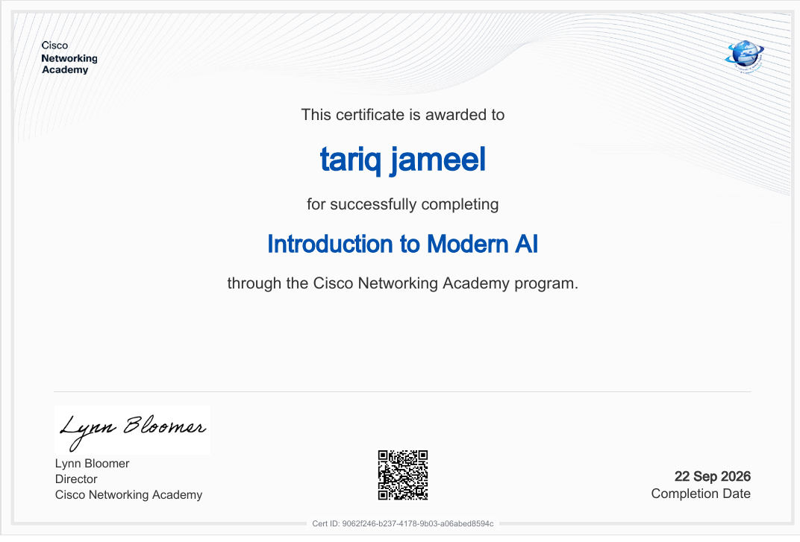
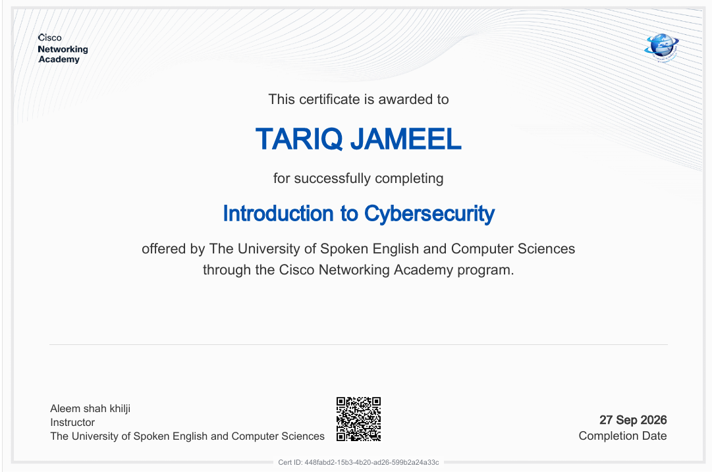

# Hi there, I'm Tariq Jameel 👋
### 💻 Co-Founder @ [xSypher](https://xsypher.com) · Full-Stack Web Developer · Cybersecurity Enthusiast
**BS Computer Engineering Student @ [CECOS University](https://www.cecos.edu.pk/)**

  <a href="#-about-me">About Me</a> •
  <a href="#-tech-stack--skills">Tech Stack</a> •
  <a href="#-featured-projects">Featured Projects</a> •
  <a href="#-certifications--achievements">Certifications</a> •
  <a href="#-github-stats">GitHub Stats</a> •
  <a href="#-connect-with-me">Connect</a>

---

## 👨‍💻 About Me

I am a design-minded **Full-Stack Developer** and **Computer Engineering** student at [CECOS University of IT & Emerging Sciences](https://www.cecos.edu.pk/) (2022 – 2026) based in Peshawar, Pakistan.

As the **Co-Founder of [xSypher](https://xsypher.com)**, I drive full-stack web engineering, modern digital transformation, and AI automation workflows. My engineering focus bridges modern software architecture with a strong emphasis on **cybersecurity**, building scalable web applications with security-first foundations, resilient APIs, and interactive UI/UX.

- 🎓 **Education:** BS in Computer Engineering (2022 – 2026) @ [CECOS University](https://www.cecos.edu.pk/)
- 🏢 **Leadership:** Co-Founder @ **[xSypher](https://xsypher.com)** — Tech & Digital Agency
- 💻 **Core Focus:** Full-Stack Web Development, Next.js / React 19, TypeScript, Node.js & API Engineering
- 🛡️ **Cybersecurity Interests:** Kali Linux, Network Architecture, Secure System Administration, and Hardening
- 🤖 **AI & Automation:** Gemini AI API integrations, WhatsApp Cloud API, Meta Graph API & n8n Workflows
- 📍 **Location:** Peshawar, Pakistan

---

## 🛠️ Tech Stack & Skills

### 🌐 Frontend Engineering

  
  
  
  
  
  
  

### ⚙️ Backend & Databases

  
  
  
  
  
  

### 🛡️ Cybersecurity & Core Systems

  
  
  
  

### 🧰 Tools, Cloud & Automation

  
  
  
  
  
  
  

---

## 📌 Featured Projects

| Project | Tech Stack | Description | Links |
| :--- | :--- | :--- | :---: |
| **xSypher** | Next.js, TypeScript, Tailwind, AI | Official digital agency platform co-founded to deliver high-performance web software and AI automations. | [🌐 Live Demo](https://xsypher.com) |
| **Venture Pakistan** | Next.js 15, Gemini AI, Tailwind v4, Express | Premium interactive AI travel concierge and journey planner for Northern Pakistan destinations. | [💻 Repo](https://github.com/tariq-jameel-2024/venture-pakistan) |
| **TJ Brand Atelier** | Next.js, React, Tailwind CSS | Elegant portfolio & digital brand atelier showcase with custom motion interactions. | [💻 Repo](https://github.com/tariq-jameel-2024/tj-brand-atelier) · [🌐 Live Demo](https://tj-brand-atelier.vercel.app) |
| **LifeCare Academy** | React, Node.js, Modern CSS | Healthcare & educational portal designed with structured learning paths and responsive UI. | [💻 Repo](https://github.com/tariq-jameel-2024/lifecareacademy) · [🌐 Live Demo](https://lifecareacademy.vercel.app) |
| **Modern Developer Portfolio** | Next.js, Framer Motion, TypeScript | Interactive portfolio website featuring an embedded AI concierge and responsive CV modal. | [💻 Repo](https://github.com/tariq-jameel-2024/tj-portfolio) |
| **Exam Marks Calculator** | JavaScript, HTML5, CSS3 | Clean academic utility for computing cumulative semester grades, marks, and GPA averages. | [💻 Repo](https://github.com/tariq-jameel-2024/exam-marks-calculator) |
| **Hotel Management System** | C++, Object-Oriented Architecture | Comprehensive console system managing room bookings, customer billing, and reservations. | [💻 Repo](https://github.com/tariq-jameel-2024/Hotel-Management-System-C-) |

---

## 📜 Certifications & Achievements

| Certificate Preview | Credential Details |
| :---: | :--- |
|  | **Introduction to Modern AI** 🏛️ **Issuer:** Cisco Networking Academy 📅 **Date Issued:** 22 September 2026 🔑 **Credential ID:** `9062f246-b237-4178-9b03-a06abed8594c` 🎯 **Skills:** Artificial Intelligence Fundamentals, Machine Learning Concepts |
|  | **Introduction to Cybersecurity** 🏛️ **Issuer:** Cisco Networking Academy / USECS 📅 **Date Issued:** 27 September 2026 🔑 **Credential ID:** `448fabd2-15b3-4b20-ad26-599b2a24a33c` 🎯 **Skills:** Cyber Threat Landscape, Defensive Security, Network Protection Basics |

---

## 📊 GitHub Stats

  
  

 

  

---

## 📫 Connect With Me

Feel free to reach out for collaborations, full-stack web engineering, or cybersecurity discussions:

  
  
  
  
  

  Designed & engineered by <b>Tariq Jameel</b>. Powered by GitHub.

